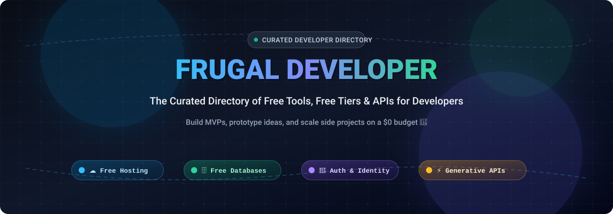

<div align="center">
  <a href="https://frugal-developer.netlify.app">
    
  </a>

  <br/><br/>

  <a href="https://github.com/ishandutta2007/Awesome-Awesome-Awesome"></a>
  <a href="https://discord.gg/jc4xtF58Ve"></a>
  <a href="https://frugal-developer.netlify.app"></a>
  <a href="https://opensource.org/licenses/MIT"></a>
  <a href="https://frugal-developer.netlify.app/new-stuff"></a>
  <a href="https://github.com/ishandutta2007/frugal-developer/stargazers"></a>
  <a href="https://github.com/ishandutta2007"></a>

  <br/><br/>

  <h3>✨ Build &amp; ship your ideas without spending a fortune ✨</h3>
  <p>🌐 <strong>Live Directory &amp; Search:</strong> <a href="https://frugal-developer.netlify.app"><strong>frugal-developer.netlify.app</strong></a> 🚀</p>
</div>

---

## 📖 Overview 💡

**Frugal Developer** is an open-source, curated collection of **free developer tools**, **free-tier cloud services**, **APIs**, **databases**, **web hosting**, **authentication**, and **serverless infrastructure**. 🛠️

When building prototypes, indie hacker products, side projects, or early MVPs, infrastructure bills can quickly add up. This collection helps software engineers, indie makers, students, and startups build, test, and ship full-stack web and mobile applications with generous free tiers (perpetually free or at least 1-year free trial). 💸✨

Inspired by [other awesome list sites](https://frugal-developer.netlify.app/tags/awesome-list/), built with the [Hugo](https://gohugo.io/) static site generator and deployed seamlessly on [Netlify](https://www.netlify.com/). ⚡

---

## 🗂️ Categories of Free Tools 🧰

Explore categorized resources on [frugal-developer.netlify.app](https://frugal-developer.netlify.app):

- ☁️ **Web Hosting & PaaS / Serverless:** Static web hosting, frontend deployment, container runtimes, serverless compute functions.
- 🗄️ **Databases & BaaS:** Managed PostgreSQL, MySQL, NoSQL, Redis, Vector databases, and Firebase/Supabase style backends.
- 🔐 **Authentication & Security:** User identity, OAuth providers, secrets management, SSL certificates, access control.
- 🔌 **APIs & Webhooks:** Generative AI & ML endpoints, payment gateways, messaging/SMS, transactional emails, geolocation.
- 📊 **Monitoring, Analytics & CI/CD:** Real-time log monitoring, error tracking, automated CI/CD pipelines, synthetic uptime alerts.
- 🛠️ **Developer Productivity:** Design assets, modern code editors, mock data generators, screenshot tools, and collaboration utilities.

---

## 📜 Contribution Rules 📌

We love contributions! To keep this repository focused and high quality:

1. 💎 **Free Tier Requirement:** The service must offer a perpetually free tier or a free trial lasting at least 1 year without requiring an upfront paid subscription.
2. 🚫 **General / Platform-Agnostic Tools Only:**
   - ❌ **No language/framework-specific tools:** (e.g., Hugo themes, React UI libraries, npm utility packages).
   - ❌ **No libraries or framework packages:** (e.g., JavaScript npm packages, Python wheels).
   - ❌ **No documentation sites or community forums:** Links should be to the actual tool or service.

---

## 🤝 How to Contribute 🚀

Want to submit a new service or free tool?

### ⚡ Method 1: Interactive Submission Form (Fastest)
Use the [New Stuff Submission Form](https://frugal-developer.netlify.app/new-stuff). It will prefill the required values and help generate your pull request automatically.

### ✍️ Method 2: Manual Pull Request

1. 🍴 Fork this repository.
2. 📄 Create a new markdown file inside `content/stuff/<service-name>.md` (e.g., `content/stuff/myservice.md`).
3. 📝 Fill in the service details using this template:

```toml
+++
date = 2026-11-05T00:00:00+00:00
title = "Your Service Name"
link = "https://link.to.service"
thumbnail = "https://any.logo.of/service"
snippet = "Service description, shown under the service name"
tags = ["hosting", "database"]
+++ 
Free feature 1 (e.g., 500 MB free storage)
Free feature 2 (e.g., 10,000 requests/month)
Free feature 3
```

> 💡 **Submission Tips:**
> - Avoid small 16x16 favicons; thumbnails are automatically resized to **80x80**.
> - Browse existing tags at [frugal-developer.netlify.app](https://frugal-developer.netlify.app/) under "Filter".
> - List each free-tier feature or quota limit on its own line.

#### 🔍 Real-world Example: [`content/stuff/netlify.md`](content/stuff/netlify.md)
```toml
+++
date = "2021-06-15T00:00:00+00:00"
tags = ["hosting", "hosting-dynamic", "hosting-static", "serverless"]
title = "Netlify"
link = "https://www.netlify.com/"
thumbnail = "https://res.cloudinary.com/wegoatdev/image/upload/v1623795952/frugal-developer/stuff/netlify.png"
snippet = "An intuitive Git-based workflow and powerful serverless platform to build, deploy, and collaborate on web apps"
+++
Host static and serverless function
Bandwidth: 100GB /month
Build Minutes: 300 Minutes /month
Websites: Unlimited
Serverless Functions: 125k per site /month
Forms: 100 /site/month
Identity: 1K /site/month
```

---

## 💖 Support & Sponsorship ☕

Thank you so much for checking out and using **Frugal Developer**! 🙏  
If you find this project useful or it helped you save money while building your MVP, please consider supporting the project:

- ⭐ **Star this repository** to help others discover it!
- 🍴 **Fork it and contribute** new free tools to keep the community directory up-to-date.
- 📢 **Share it** on Twitter, LinkedIn, Reddit, or developer forums with fellow builders.
- ☕ **Buy me a coffee / Sponsor:** You can support continuous maintenance and new feature development via the [GitHub Sponsors Dashboard](https://github.com/sponsors/ishandutta2007).

Your support is deeply appreciated! 🌟

---

## 🤝 Code of Conduct 🕊️

`frugal-developer` is open for contribution from developers around the world regardless of nationality, gender, or background.
- 💛 Show empathy and respect.
- 🤝 Be patient and constructive with feedback.

Questions or feedback? Open an [issue](https://github.com/ishandutta2007/frugal-developer/issues) or reach out on Twitter/X: [@ishandutta2007](https://twitter.com/ishandutta2007).

---

## 👥 Contributors 🌟

Thanks goes to these wonderful people:

<a href="https://github.com/ishandutta2007/frugal-developer/graphs/contributors">
  
</a>

---

## 📈 Star History

[](https://star-history.dera.page/#ishandutta2007/frugal-developer&type=date&legend=top-left)

---

## 📄 License & Credits 📝

- ⚖️ **License:** [MIT License](LICENSE)
- 🙏 **Credits:** Inspired by [freeStuffDev](https://github.com/hilmanski/freeStuffDev) by Hilman Ramadhan.
