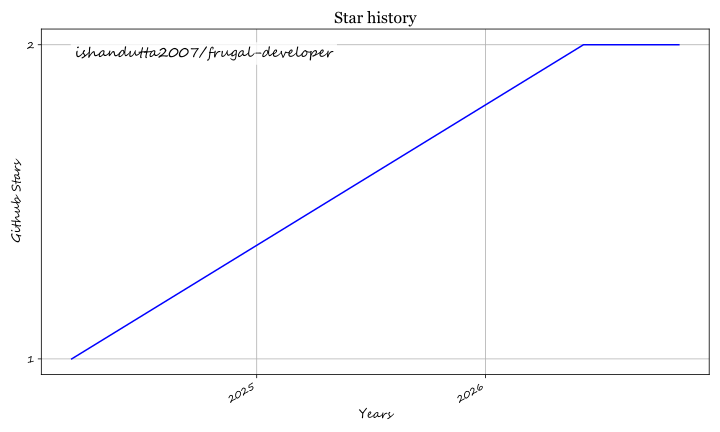

<div align="center">
  

  # Frugal Developer 💸⚡

  **A curated list of free developer tools, free-tier cloud services, and APIs for building MVPs and side projects without spending a dime.**

  [](https://frugal-developer.netlify.app)
  [](https://opensource.org/licenses/MIT)
  [](https://frugal-developer.netlify.app/new-stuff)
  [](https://github.com/ishandutta2007/frugal-developer/stargazers)

  🌐 **Live Site:** [frugal-developer.netlify.app](https://frugal-developer.netlify.app)
</div>

---

## 📖 Overview

**Frugal Developer** is a comprehensive, community-driven catalog of **free developer tools**, **free-tier cloud services**, **APIs**, **databases**, **web hosting**, **authentication**, and **serverless infrastructure**. 

When building prototypes, indie hacker products, side projects, or early MVPs, infrastructure costs can pile up quickly. This collection helps software engineers, indie makers, and students build and ship full-stack applications with generous free tiers or completely free tiers (at least 1-year free trial).

Inspired by [other awesome list sites](https://frugal-developer.netlify.app/tags/awesome-list/), built with the [Hugo](https://gohugo.io/) static site generator and deployed on [Netlify](https://www.netlify.com/).

---

## 🗂️ Categories of Free Tools

Explore categorized resources on [frugal-developer.netlify.app](https://frugal-developer.netlify.app):

- ☁️ **Web Hosting & PaaS / Serverless:** Static hosting, frontend deployment, container runtimes, serverless functions.
- 🗄️ **Databases & BaaS:** Managed PostgreSQL, MySQL, NoSQL, Redis, Vector DBs, and backend-as-a-service platforms.
- 🔐 **Authentication & Security:** User identity, OAuth providers, secrets management, SSL certificates.
- 🔌 **APIs & Webhooks:** Generative AI & ML APIs, payment gateways, messaging/SMS, email delivery, geolocation.
- 📊 **Monitoring, Analytics & CI/CD:** Application logs, error tracking, automated CI/CD pipelines, uptime alerts.
- 🛠️ **Developer Productivity:** Design tools, code editors, mock data generators, screenshot APIs, and collaboration tools.

---

## 📜 Contribution Rules

We love contributions! To keep this repository focused and high quality:

1. **Free Tier Requirement:** The service must offer a perpetually free tier or a free trial lasting at least 1 year without requiring an upfront paid subscription.
2. **General / Platform-Agnostic Tools:**
   - ❌ **No language/framework-specific tools:** (e.g., Hugo themes, React UI libraries, npm utility packages).
   - ❌ **No libraries or framework packages:** (e.g., JavaScript npm packages, Python wheels).
   - ❌ **No documentation sites or community forums:** Links should be to the actual tool or service.

---

## 🤝 How to Contribute

Want to submit a new service or free tool?

### Method 1: Interactive Submission Form (Fastest)
Use the [New Stuff Submission Form](https://frugal-developer.netlify.app/new-stuff). It will prefill the required values and help generate your pull request automatically.

### Method 2: Manual Pull Request

1. Fork this repository.
2. Create a new markdown file inside `content/stuff/<service-name>.md` (e.g., `content/stuff/myservice.md`).
3. Fill in the service details using this template:

```toml
+++
date = 2026-11-05T00:00:00+00:00
title = "Your Service Name"
link = "https://link.to.service"
thumbnail = "https://any.logo.of/service"
snippet = "Service description, shown under the service name"
tags = ["hosting", "database"]
+++ 
Free feature 1 (e.g., 500 MB free storage)
Free feature 2 (e.g., 10,000 requests/month)
Free feature 3
```

> **Submission Tips:**
> - Avoid small 16x16 favicons; thumbnails are automatically resized to **80x80**.
> - Browse existing tags at [frugal-developer.netlify.app](https://frugal-developer.netlify.app/) under "Filter".
> - List each free-tier feature or quota limit on its own line.

#### Real-world Example: [`content/stuff/netlify.md`](content/stuff/netlify.md)
```toml
+++
date = "2021-06-15T00:00:00+00:00"
tags = ["hosting", "hosting-dynamic", "hosting-static", "serverless"]
title = "Netlify"
link = "https://www.netlify.com/"
thumbnail = "https://res.cloudinary.com/wegoatdev/image/upload/v1623795952/frugal-developer/stuff/netlify.png"
snippet = "An intuitive Git-based workflow and powerful serverless platform to build, deploy, and collaborate on web apps"
+++
Host static and serverless function
Bandwidth: 100GB /month
Build Minutes: 300 Minutes /month
Websites: Unlimited
Serverless Functions: 125k per site /month
Forms: 100 /site/month
Identity: 1K /site/month
```

---

## 🤝 Code of Conduct

`frugal-developer` is open for contribution from developers around the world regardless of nationality, gender, or background.
- Show empathy and respect.
- Be patient and constructive with feedback.

Questions or feedback? Open an [issue](https://github.com/ishandutta2007/frugal-developer/issues) or reach out on Twitter/X: [@ishandutta2007](https://twitter.com/ishandutta2007).

---

## 👥 Contributors

Thanks goes to these wonderful people:

<a href="https://github.com/ishandutta2007/frugal-developer/graphs/contributors">
  
</a>

---

## ⭐ Star History

<a href="https://star-history.com/#ishandutta2007/frugal-developer&Timeline" align="center">
  <picture>
    <source media="(prefers-color-scheme: dark)" srcset="assets/ishandutta2007_frugal-developer_growth.svg">
    
  </picture>
</a>

---

## 📄 License & Credits

- **License:** [MIT License](LICENSE)
- **Credits:** Inspired by [freeStuffDev](https://github.com/hilmanski/freeStuffDev) by Hilman Ramadhan.
